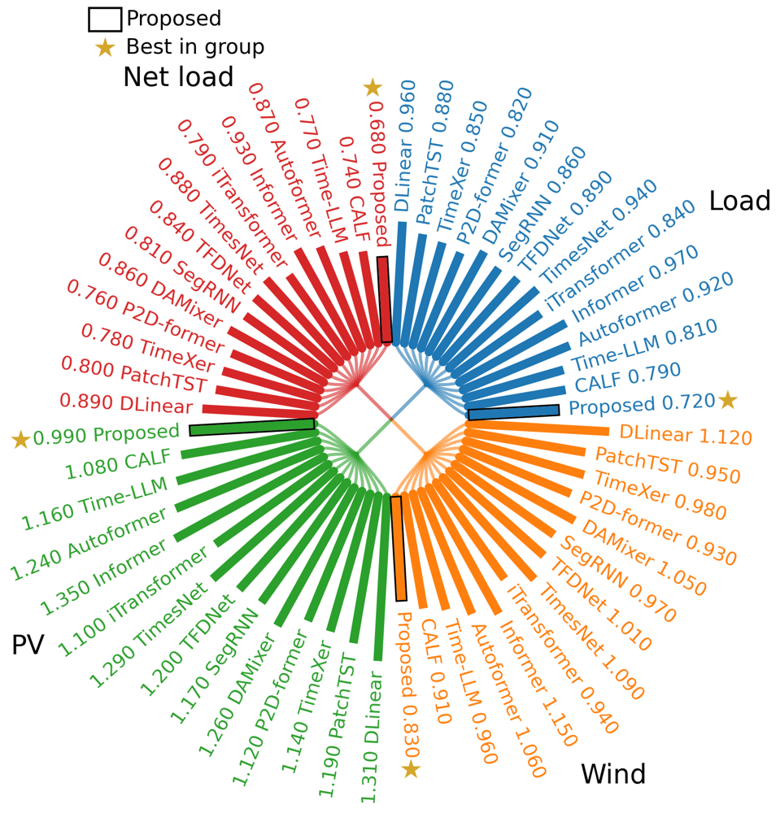
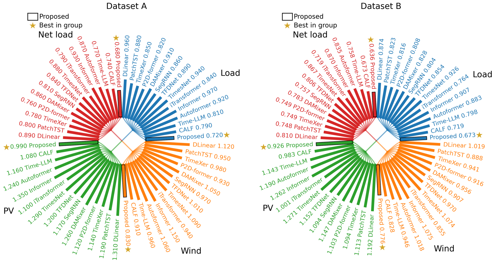

# Pancake

用 Matplotlib 画分组径向比较图：中心细曲线汇聚，外圈柱条标注模型和数值，黑框强调指定方法，金星标出各组最优值。

默认采用 Matplotlib 的颜色周期、无衬线字体和白底，支持 Python 字典、CSV、并列多图，以及 PNG、PDF、SVG 导出。Python 模块名为 **`radialbundle`**。



> 文档、CSV 和示例图中的数值均为虚构数据，仅演示绘图。

## 安装

```bash
python -m pip install "git+https://github.com/DDG-114/Pancake.git"
```

或者克隆后安装：

```bash
git clone https://github.com/DDG-114/Pancake.git
cd Pancake
python -m pip install -e .
python examples/basic.py
```

## 用自己的数据绘图

数据格式为“分组 → 模型 → 数值”：

```python
from radialbundle import plot, save

data = {
    "Load":     {"DLinear": 0.81, "PatchTST": 0.75, "Proposed": 0.67},
    "Wind":     {"DLinear": 0.79, "PatchTST": 0.73, "Proposed": 0.64},
    "PV":       {"DLinear": 0.95, "PatchTST": 0.88, "Proposed": 0.80},
    "Net load": {"DLinear": 0.83, "PatchTST": 0.76, "Proposed": 0.68},
}

fig, ax = plot(
    data,
    highlight="Proposed",      # 黑框强调的方法
    value_format=".3f",         # 保留三位小数
    lower_is_better=True,       # 准确率等指标改为 False
)
save(fig, "my_figure")          # 导出 PNG、PDF、SVG
```

分组和模型按字典中的顺序顺时针排列。四组形成菱形中心，也支持其他分组数；每盘至少两组。每组 14 个模型时，全圆共有 56 根柱，能够形成密排效果；模型少时相应更疏。

## 读取 CSV

可直接修改 [`examples/results.csv`](examples/results.csv)，保留列名 `group,model,value`：

```csv
group,model,value
Load,DLinear,0.810
Load,Proposed,0.670
Wind,DLinear,0.790
Wind,Proposed,0.640
```

```python
from radialbundle import read_csv, plot, save

data = read_csv("results.csv")
fig, ax = plot(data, highlight="Proposed", value_format=".3f")
save(fig, "results")
```

也可用命令行直接生成：

```bash
python -m radialbundle examples/results.csv --output results --highlight Proposed --decimals 3 --formats png pdf svg
```

CSV 可增加 `panel` 列区分多个数据集。Python 用 `read_csv("results.csv", panel="Dataset A")` 选择一个面板；命令行默认画出所有面板，也可用 `--panel "Dataset A"` 单独选择。

## 两张图并列



```python
from radialbundle import plot_panels, save

panels = {"Dataset A": data_a, "Dataset B": data_b}
fig, axes = plot_panels(
    panels,
    ncols=2,
    share_scale=True,
    highlight="Proposed",
    value_format=".3f",
)
save(fig, "two_datasets")
```

`data_a` 和 `data_b` 都采用上面的分组字典格式。完整示例见 [`examples/two_panels.py`](examples/two_panels.py)。

同一指标、同一单位可用 `share_scale=True`，使不同面板中相同数值的柱条长度相同。默认各面板独立缩放；单个圆盘内所有分组始终共用同一线性尺度。

## Matplotlib 风格和自定义样式

默认配色跟随 `axes.prop_cycle`，字体跟随 `font.family`，背景跟随 `figure.facecolor`，因此也可以使用 Matplotlib 的样式上下文：

```python
import matplotlib.pyplot as plt
from radialbundle import plot, save

with plt.style.context("bmh"):
    fig, ax = plot(data, highlight="Proposed")
    save(fig, "styled_figure")
```

可以单独指定字体、字号、字重、柱宽和颜色：

```python
from radialbundle import Style, plot

style = Style(
    font_family="DejaVu Sans",
    font_weight="normal",
    group_weight="medium",
    label_size=10,
    group_label_size=14,
    legend_size=11,
    bar_width=4.6,
    branch_alpha=0.6,
)

fig, ax = plot(
    data,
    style=style,
    colors=["tab:blue", "tab:orange", "tab:green", "tab:red"],
    highlight="Proposed",
    highlight_label="本文方法",
    best_label="最优模型",
    background="white",          # 灰底可用 "#c8c8c8"
)
```

中文优先使用 Microsoft YaHei，缺失时尝试 Noto Sans CJK 等字体；也可用 `Style(cjk_font="本机字体名")` 指定。传入 `ax` 可画到自己的 Matplotlib 子图中；返回的 `fig` 和 `ax` 可继续修改。绘图不会改写全局 `rcParams`。

`save(fig, "output/figure", formats=("pdf", "svg"), dpi=300)` 可选择导出格式；PDF 嵌入字体，SVG 保留可编辑文字。

## 数据与标记

- 数值使用非负有限数，柱长从零开始按数值线性增长。同一圆盘宜使用同一指标和可比单位。
- `None` 或 CSV 空值、`NA`、`NaN`、`--` 表示缺失，保留标签位置，不画成零值，不参与最优比较。
- 黑框表示 `highlight` 指定的方法；金星按每组实际数值选择最优方法，相同原始数值并列最优时全部标星。
- 任务名和最优星号会避让外圈文字。模型名过长或条目过密时，可减小 `label_size`、增大图尺寸或缩短名称。

## 示例与验证

```bash
python examples/basic.py
python examples/from_csv.py
python examples/two_panels.py
python -m unittest discover -s tests -v
```

示例输出在 `examples/output/`；库代码在 `src/radialbundle/`。
